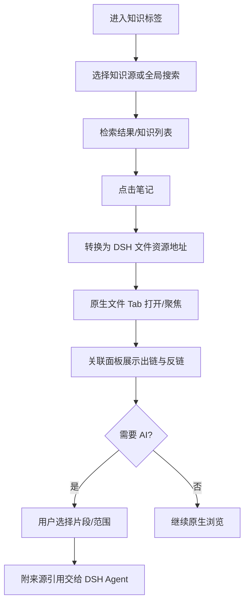
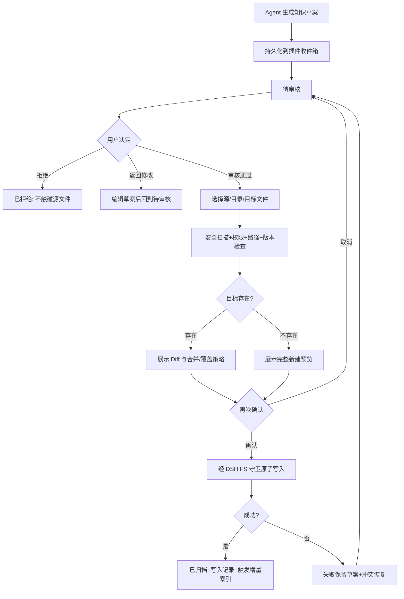

# dsh-obsidian 智能知识工作台

> 产品需求、交互设计与技术方案 v1.0
> 更新日期：2026-11-02
> 状态：设计基线 / 待对接实际 DSH 运行版本验证
> 适用范围：DSH Desktop 独立插件；不依赖 `dsh-enhanced`
> 设计关键词：Native-first / Local-first / Review-before-write / Apple-inspired

---

## 0. 已确定的产品决策

| 编号 | 决策 | 具体含义 |
|---|---|---|
| DEC-01 | **新增「知识」标签** | 与现有 DSH 导航体系平级进入知识工作台，不替换「文件」页面。实际插入位置与扩展方式需要对当前安装版本做接口验证。 |
| DEC-02 | **支持双知识源** | 既能关联现有 Obsidian Vault，也能把普通 DSH 项目目录作为可检索知识源。 |
| DEC-03 | **AI 先提议后写入** | AI 输出先进入知识收件箱；人工审阅、选择目标、查看差异并确认后才落盘。 |
| DEC-04 | **复用 DSH 原生文件能力** | 文件操作、地址、工作区与文档 Tab 的最终所有权属于 DSH；插件不另造第二套文件管理器。 |
| DEC-05 | **与 dsh-enhanced 独立** | 两者不互相依赖；有 `dsh-enhanced` 时可享受其文件编辑增强，没有时仍可完成知识管理、阅读和已授权写入。 |
| DEC-06 | **不要求 Obsidian 客户端** | Vault 是本地目录，兼容 Markdown、链接、属性和附件的常用语义，不模拟 Obsidian 插件运行时。 |

### 一句话定位

**dsh-obsidian 是 DSH 的原生知识工作台：把本地文件组织成可检索、可引用、可审阅并可复用的知识，让 Agent 的工作成果成为长期资产。**

### 非目标

- 不接管 DSH 的原生文件面板、文件 Tab、分栏管理、文件保存机制。
- 不重复建设 DOCX/XLSX/PDF/图片等通用编辑引擎；这些由 DSH 原生或 `dsh-enhanced` 完成。
- 不执行 Obsidian 社区插件，不尝试完全兼容其插件 API。
- V1 不做全自动无人审核写入，不将源 Markdown 自动替换为专有数据库格式。
- 不因插件安装就自动扫描用户整个磁盘或将知识库发送给远程模型。

---

## 1. 用户角色、核心场景和信息架构

### 1.1 核心场景

- **日常知识管理**：从「知识」快速打开笔记、搜索、查看标签和反向链接。
- **开发与文档工作**：DSH Agent 在执行任务时，按授权范围检索项目设计、研发经验、README、规范等资料，回答问题并附引用。
- **经验沉淀**：任务完成后，Agent 提议整理为知识卡片；用户在收件箱审核后写入目标目录。
- **双目录协同**：一个 Obsidian Vault 保存长期知识，另一个普通项目目录提供项目级背景和参考；既可独立检索，也可联合查询。

### 1.2 信息架构

```text
DSH Desktop
├─ 现有导航 / 会话（保持）
├─ 「知识」新增入口 ← dsh-obsidian
│  ├─ 概览：当前知识库、最近、收藏、待审核
│  ├─ 搜索：全文、标题、标签、属性、相关内容
│  ├─ 知识库：Vault / 项目目录源、索引状态、访问范围
│  ├─ 收件箱：待审核 → 差异检查 → 确认写入 → 记录
│  ├─ 关联：当前笔记的出链、反链、相关笔记
│  └─ 设置：知识源、忽略规则、AI 访问、索引和安全
└─ DSH 原生右侧文件 Tab（保持）
   └─ 打开文件、现有预览器、可选增强编辑器
```

知识导航与文件导航是**语义分工**，不是两套文件源：

- DSH 「文件」负责“文件在哪、如何打开/编辑”；
- 「知识」负责“与什么有关、何处提到它、怎样检索、什么内容值得沉淀”。

### 1.3 三个对象，避免混淆

| 对象 | 说明 | 典型例子 |
|---|---|---|
| `KnowledgeSource` | 索引与权限边界，指向已授权目录 | 工作知识库 Vault、当前 Java 项目 |
| `KnowledgeNote` | 可作为知识节点的 Markdown 文件；普通项目文档可成为可检索资源 | `架构决策.md`、`README.md` |
| `KnowledgeProposal` | 待审核的 AI 操作草案；不等于源文件 | “将连接池故障经验归档” |

普通项目目录中，`js/java/json/ts` 等文件**默认作为检索参考资料，不强制转成 Markdown 笔记**；只有用户选择创建知识卡片时，才把总结写入目标知识库的 Markdown 文件。

---

## 2. 完整交互设计

### 2.1 屏幕 A：「知识」概览页（默认）

```text
┌─────────────────────────────────────────────────────────────────────────┐
│ DSH 现有导航：对话 / Git / 上下文 / [知识]  （视觉、交互遵从宿主）         │
├───────────────────────┬─────────────────────────────────────────────────┤
│ 知识                  │  DSH 原生右侧工作区 / 文件 Tab                    │
│ [🔍 搜索知识…   ⌘K]  │  [架构决策.md]   [README.md]                     │
│                       │                                                 │
│ 工作知识库       ▾   │   # 统一流程中心架构                             │
│ [最近] [收藏] [收件箱 3]│                                                 │
│                       │   文档正文由 DSH 原生文档组件显示                │
│ ▾ 项目架构             │                                                 │
│   架构设计             │                                                 │
│   API 规范             │                                                 │
│ ▸ 技术经验             │                                                 │
│ ▸ 项目资料             │                                                 │
│                       │                                                 │
│ 关联知识               │                                                 │
│  ↗ 出链 4  ↙ 反链 7   │                                                 │
│                       │                                                 │
│ [＋ 新建笔记] [⚙]    │                                                 │
└───────────────────────┴─────────────────────────────────────────────────┘
```

**交互规则**

1. 进入知识标签，恢复上一次选中的知识源与子页面；首次打开显示引导空态。
2. 点击笔记：把该文件交给 DSH 的资源导航打开，优先复用已存在的原生文件 Tab，而不是创建插件自己的编辑 Tab。
3. 普通文件在知识结果中显示类型图标；点击同样由 DSH 原生文档系统处理。
4. 知识区域宽度不足时收起非必要信息，保持搜索和列表可用；目录树不是复制的文件浏览器，采用语义分组/最近/标签/关联视图。
5. 当前没有授权源时明确显示「添加知识库」，禁止“空白页无反馈”。

### 2.2 屏幕 B：添加知识源向导

```text
┌─ 添加知识源 ─────────────────────────────────┐
│ 选择类型                                      │
│  ◉ 已有 Obsidian Vault   ○ 普通项目目录       │
│                                                │
│ 路径 / 选择已授权工作区目录                    │
│ [当前 DSH 工作区 /project                  ▾] │
│                                                │
│ 索引内容                                      │
│ ☑ Markdown   ☑ txt   ☑ README / 文档          │
│ ☐ 代码及配置文件（需明确启用）                  │
│                                                │
│ 忽略路径                                      │
│ .git  node_modules  dist  build  .obsidian/** │
│                                                │
│ AI 可以引用此知识源？    [仅检索 / 禁用]       │
│                                                │
│           [取消] [验证权限并建立索引]          │
└────────────────────────────────────────────────┘
```

**差异处理：**

- Vault：可识别 `.obsidian` 目录（不是必要条件）；读取现有 Markdown、Properties、附件与 Wikilinks；不擅自更改 `.obsidian` 设置。
- 普通项目目录：优先识别 README / docs / ADR / md；按规则扩展可检索文本文件；默认忽略构建产物与秘密文件。
- 位于 DSH 当前授权工作区之外的 Vault：**先授权或切换到对应工作区**；若宿主 API 不支持独立目录挂载，则显示“需先通过 DSH 打开该目录”，不绕过沙箱直接访问。
- 不允许将两个源配置为重复或嵌套索引导致同一笔记重复计算；重叠时提示并要求确定索引归属。
- 新增知识源时，默认只做本地索引，AI 使用需要用户单独开启。

### 2.3 屏幕 C：知识搜索

```text
┌─ 搜索知识 ──────────────────────────────────────────┐
│ 🔍 [Deployment 数据隔离                        ]  ⌘↵ │
│ 源：[全部 ▾] 类型：[全部 ▾] 标签：[全部 ▾]           │
│                                                    │
│ 笔记 / 全文                                        │
│ ┌────────────────────────────────────────────────┐ │
│ │ 运行单元架构.md        工作知识库 / 架构          │ │
│ │ …每个 Deployment 可以配置独立的数据库连接…      │ │
│ └────────────────────────────────────────────────┘ │
│ ┌────────────────────────────────────────────────┐ │
│ │ application.yml       项目目录 / backend       │ │
│ │ …datasource…                                   │ │
│ └────────────────────────────────────────────────┘ │
│                                                    │
│ [打开到原生文件 Tab]  [引用到当前对话]              │
└────────────────────────────────────────────────────┘
```

**交互规则**

- 统一搜索框提供“搜索文件/笔记”与“向 AI 提问”两个清晰动作，避免用户误以为每次输入都会调用模型。
- MVP 支持标题、路径、正文全文、标签和属性过滤；V1 可选增量语义搜索。
- 搜索结果显示来源、具体片段及匹配位置；点击用 DSH 原生文件 Tab 打开并尽可能定位行/标题。若宿主暂不支持精准跳转，先打开文件并给出行号。
- 引用到对话时，只附选中片段及源位置，不默认附整个知识库。
- 保证结果来源可追踪、无权限文件不出现在结果中。

### 2.4 屏幕 D：当前笔记关联面板

```text
┌─ 知识关联 ─────────────────────────────┐
│ 当前：架构决策.md                      │
│ [反向链接 7] [出链 4] [标签 3]        │
│                                        │
│ 反向链接                               │
│ • 采购技术规范.md  第 18 行          │
│ • Deployment 隔离.md  第 42 行       │
│                                        │
│ 出链                                   │
│ • [[运行单元设计]]                    │
│ • [[数据库隔离]]                      │
│                                        │
│ [复制笔记链接] [查找失效引用]          │
└────────────────────────────────────────┘
```

- 支持 `[[标题]]`、`[[路径/标题]]`、`[[标题#章节]]`、`[[标题|别名]]`、Markdown 链接、YAML `tags` 和 `aliases`。
- 同名笔记要根据源域、路径、别名规则解析；歧义时弹出目标候选，不静默跳到错误文件。
- 未解析链接要有明显但克制的提示，可显示“创建笔记 / 选择目标 / 忽略”。
- 跨知识源链接属于 **dsh-obsidian 自身的扩展语义**，不可伪装成原生 Obsidian Wikilink；初版跨源只通过插件索引跳转，不自动写入不兼容链接。
- 块引用及嵌入图片等语义放入增强兼容测试，不保证所有 Obsidian 插件扩展语法都支持。

### 2.5 屏幕 E：知识收件箱（本项目最关键）

```text
┌─ 知识收件箱 ─────────────────────────────────────────────┐
│ 待审核 3   已归档 12   已拒绝 2     [筛选 ▾]           │
├───────────────────────────┬──────────────────────────────┤
│ ● 数据库连接排障经验      │  标题 [数据库连接故障排查]    │
│   来源：DSH 会话          │  目标 [工作知识库/技术经验 ▾] │
│   2 分钟前                │  标签 [Java] [数据库] [+]    │
│                           │                              │
│ ○ Deployment 数据隔离     │  预览                        │
│   来源：技术设计会话      │  ## 问题                     │
│                           │  ...                         │
│ ○ 更新开发规范            │  ## 处理步骤                 │
│   来源：项目对话          │  ...                         │
│                           │                              │
│                           │  [原文] [Diff] [来源]       │
│                           │  [拒绝] [返回修改] [确认归档]│
└───────────────────────────┴──────────────────────────────┘
```

**写入流程必须是两阶段：**

1. Agent 调用只生成草案的工具，内容入箱；此时**源文件一字未改**。
2. 审核员选择目标知识库、目录、文件名，并检查内容、来源、标签以及敏感信息。
3. 若目标已经存在，必须展示差异并选择「新建笔记 / 追加段落 / 更新原文 / 取消」。
4. 点击「确认归档」才执行受权限检查、版本保护和冲突检查的真实写入。
5. 成功后进入已归档，记录源会话、用户动作、写入路径、版本与时间；失败保留草案并显示可恢复原因。
6. 拒绝只更新收件箱状态；不删除来源会话或外部文件。
7. 批量操作仅对同一授权域内的草案开放；首版不支持一键批量覆盖多篇已有笔记。

### 2.6 屏幕 F：设置与索引状态

- **知识源**：源名称、类型、路径、授权状态、AI 可检索开关、最后索引时间、源文件数量。
- **索引策略**：默认忽略规则、自定义排除、文件大小限制、手动重建、异常索引查看。
- **隐私安全**：敏感文件排除、凭据识别、允许引用的源、AI 远程发送前预览或提示。
- **编辑行为**：新笔记模板、命名规则、写入目录默认值、是否使用 Wikilinks。
- **外观操作**：跟随 DSH 主题、紧凑视图、默认展开区块、快捷键查询与冲突检测。
- **卸载清理**：可保留源文件并删除插件专属索引与未归档草案；不会删除用户 Vault。

---

## 3. 关键交互流程

### 3.1 打开笔记并使用知识上下文



### 3.2 Agent 收件箱审核写入



### 3.3 外部文件变更

- Obsidian 或其他编辑器在插件外修改笔记 → 接收 DSH 文件变更通知或可用的文件系统观察事件 → 仅更新相关索引项、反向链接和搜索结果。
- 若用户正在编辑同一文件且本地有未保存内容 → 不自动覆盖；提示“磁盘已有新版本”，允许比较、重新读取或另存。
- 源路径失效 → 保留知识源配置但标记不可访问，隐藏其搜索结果或标注过期并限制 AI 使用。

---

## 4. 功能需求矩阵

| ID | 功能 | 验收范围 | 优先级 |
|---|---|---|---|
| K-01 | 知识标签入口 | 可独立打开、切回原有标签，不破坏现有布局 | P0 |
| K-02 | 添加 Obsidian Vault | 目录权限、识别、扫描与状态展示 | P0 |
| K-03 | 添加普通项目目录 | 作为参考源，不误把非 MD 文件当笔记 | P0 |
| K-04 | 多知识源切换 | 按源过滤、联合搜索、同名消歧 | P0 |
| K-05 | 原生文件跳转 | 通过 DSH 资源地址打开，不生成重复编辑 Tab | P0 |
| K-06 | 本地全文检索 | 标题/正文/标签/路径，带来源和定位 | P0 |
| K-07 | Wikilinks 与反向链接 | 标准内部链接、别名、章节、失效链接 | P0 |
| K-08 | 知识收件箱 | 草案持久化、审核、修改、拒绝、归档 | P0 |
| K-09 | 审核后落盘 | 写入前 Diff，版本冲突保护，失败可恢复 | P0 |
| K-10 | 文件变化同步 | 增量索引、外部修改、删除和重命名处理 | P0 |
| K-11 | AI 带来源知识问答 | 授权范围检索、引用片段可追踪 | P1 |
| K-12 | Properties/标签增强 | YAML 类型识别、标签汇总与筛选 | P1 |
| K-13 | 收藏、最近与固定知识 | 轻量工作台快捷入口 | P1 |
| K-14 | 相似笔记推荐 | 可选语义向量检索及重复内容提示 | P1 |
| K-15 | Canvas / 知识图谱 | 基于关系索引，可视化探索 | P2 |
| K-16 | Bases 兼容 | `.base` 视图的部分读取与筛选 | P2 |
| K-17 | 附件内容索引 | Office/PDF 经合规提取管道进入检索 | P2 |

**P0 的唯一成功路径：** 用户添加一个 Vault 和一个项目目录，能搜索、打开、查看反链；Agent 生成草案，用户在收件箱审核并写入，随后从 DSH 原生文件 Tab 读取到相同的文件内容。

---

## 5. 文件与知识语义设计

### 5.1 源文件与索引

- **源文件为唯一真实数据源**：Markdown 保留原始格式；索引可删除重建。
- 存储插件索引、草案与偏好的位置优先选择插件应用数据目录，避免在普通项目根目录制造无关文件。
- 知识源索引要记录文件系统身份（规范路径/目标键）、版本、修改时间、哈希（按需），不能仅以 basename 作为身份。
- 处理 UTF-8 编码、大小写差异、Unicode 文件名、同名文件与路径重命名。
- `.obsidian`、`.git` 等默认不参与内容搜索；可单独读取必要的 Vault 链接/附件设置但不修改。
- 路径包含 `..`、符号链接跳出授权范围、权限拒绝均不可索引与写入。

### 5.2 两种源的数据策略

| 维度 | Obsidian Vault | 普通项目目录 |
|---|---|---|
| 内容范围 | 默认所有 `.md` 和可解析笔记附件 | 默认 README、docs 下 Markdown/TXT；代码需显式开启 |
| 关联解析 | Wikilinks/Markdown Links/Properties | Markdown Links 优先；Wikilinks 仅在文档中出现时启用 |
| 知识归档 | 用户指定 Vault 内的目录 | 可选择指定项目文档目录，默认不直接写项目源码 |
| AI 引用 | 按 Vault 授权 | 按项目授权与排除规则 |
| 附件 | DSH 原生打开 | DSH 原生打开 |

### 5.3 初版链接解析精度

- 支持 Wikilinks、Markdown 链接、URL 解码、别名和标题锚点。
- 注意 Markdown 中代码块里的 `[[...]]` 不应视为链接，解析需使用语法树/词法状态，而非单个正则全局替换。
- 重命名笔记时**不主动批量改写**所有反链。第一版显示影响清单和改写预览，用户确认后执行；可留给宿主文件系统操作完成重命名。
- 跳转外部链接采用 DSH 默认外部链接策略，避免在知识页内任意执行脚本或加载不可信 HTML。

---

## 6. 技术架构和 DSH 集成边界

```text
                  dsh-obsidian 独立插件
┌─────────────────────────────────────────────────────┐
│ Client UI                                            │
│ KnowledgePanel | Search | Related | Inbox | Settings│
├─────────────────────────────────────────────────────┤
│ Application Services                                 │
│ SourceManager | Indexer | LinkResolver | Proposal    │
│ SearchService | CitationService | AccessGuard       │
├─────────────────────────────────────────────────────┤
│ DSH Adapters                                          │
│ PanelAdapter | ResourceNavigationAdapter | FsAdapter │
│ AgentToolAdapter | CommandAdapter | WatchAdapter     │
├─────────────────────────────────────────────────────┤
│ Storage                                               │
│ SQLite FTS/元数据 | 草案/审核记录 | 插件设置            │
└─────────────────────────────────────────────────────┘
           │                               │
           ▼                               ▼
 DSH 原生 Sidebar / Tab           DSH 文件系统 + Agent
           │                               │
           └────────── 已授权本地目录 ───────┘
                     ├─ Obsidian Vault
                     └─ 普通项目目录
```

### 6.1 已核验的公开能力

| 能力 | 公开接口/机制 | 实现建议 | 风险 |
|---|---|---|---|
| 左侧独立导航面板 | `sidebar.panellist` 和 root `main` keyed slot | 优先实现知识入口；**是否能插入用户截图所示“对话/Git/上下文”同一条 tab strip 仍需实机验证** | 中 |
| 右侧页面/文件 Tab | `ctx.sidebarRightTabs`、`ctx.sidebarRight` | 知识视图可注册 `knowledge` 页；打开文件仍优先 `openResource` | 低 |
| 原生文件树 | `files` 内置 tab | 保留，不替换 | 低 |
| 文件预览 | `ctx.documentPreviews` | 原有 Markdown/Office 预览由 DSH（可选 dsh-enhanced）负责 | 低 |
| 已授权文件浏览与读取 | `ctx.workspaceFiles`、`remote.workspaceFiles` | 只读预览、目录列表、变更流；不当作可写 API | 低 |
| 文件读写 | `ctx.fs` 提供 `readText`、`writeText` 等 | Host 层经授权、版本保护和写入审批适配 | 中 |
| Agent 工具 | DSH 插件工具/命令注册机制 | 只读检索与写入草案工具分开 | 中 |

**必须在代码审计中验证**：现有用户安装的 DSH RC 版本、Web Client UI 插件注册与 Desktop 打包差异、跨源路径授权、前后端 RPC、知识视图注入位置、文件导航定位、写入策略事件。禁止仅凭公开文档默认与安装版本完全一致。

### 6.2 原生文件能力的硬约束

- `workspaceFiles` 是**浏览/读取/观察**路线，不是可用于修改文件的开放 `write` 接口。
- `ctx.fs` 的裸 `writeText` / `editText` 是基础能力，不自动等同于用户批准了 AI 写入；插件需在上层强制权限、审查及版本守卫。
- Host 与 Client 跨边界交互必须使用已注册 RPC，不从浏览器直接访问 `node:fs`。
- 对于当前 Session 之外的知识源，授权不足时禁用该源，不得偷用宿主高权限路径去绕过限制。
- 如果不能依赖用户当前登录态向外部服务发送文档内容，使用离线全文搜索；语义检索默认关闭或需要用户开启。

### 6.3 建议目录结构

```text
dsh-obsidian/
├── packages/
│   ├── core/                 # 纯算法、数据结构、链接解析
│   ├── host/                 # 授权文件读写、索引、持久化
│   ├── client/               # 知识界面、交互状态
│   └── agent-tools/          # Agent 搜索、阅读、提交草案
├── src/
│   ├── adapters/             # dsh fs / tab / commands / RPC
│   ├── features/
│   │   ├── sources/
│   │   ├── explorer/
│   │   ├── search/
│   │   ├── links/
│   │   ├── inbox/
│   │   └── settings/
│   └── index.ts
├── tests/
│   ├── core/
│   ├── integration/
│   └── e2e/
└── docs/
    ├── architecture.md
    ├── compatibility-matrix.md
    └── security-model.md
```

目录为推荐逻辑结构，最终应遵循 DSH 实际插件包工程约定，不强制拆成独立工作区包。

---

## 7. 数据模型与接口设计（建议）

### 7.1 核心实体

```ts
type SourceKind = 'obsidian-vault' | 'project-directory';
type ProposalStatus = 'draft' | 'pending' | 'approved' | 'rejected' | 'conflict' | 'applied';

type KnowledgeSource = {
  id: string;
  name: string;
  kind: SourceKind;
  rootUri: string;               // 授权的规范目录 URI，不暴露原始主机路径给无权 UI
  workspaceId?: string;           // 与 DSH Workspace / Session 关联
  readEnabled: boolean;
  aiRetrievalEnabled: boolean;    // 初始 false；用户主动授权
  writeEnabled: boolean;          // 初始 false；审核时仍需检查
  includeGlobs: string[];
  excludeGlobs: string[];
  indexRevision: number;
};

type KnowledgeDocument = {
  sourceId: string;
  relativePath: string;
  fileIdentity: string;           // DSH 后端规范身份，处理路径别名
  fileVersion: string;
  kind: 'note' | 'reference' | 'attachment';
  title: string;
  aliases: string[];
  tags: string[];
  indexedAt: string;
};

type SourceReference = {
  sourceId: string;
  path: string;
  startLine?: number;
  endLine?: number;
  fileVersion?: string;
};

type KnowledgeProposal = {
  id: string;
  status: ProposalStatus;
  originSessionId?: string;
  originToolCallId?: string;
  originRefs: SourceReference[];
  proposedTitle: string;
  proposedMarkdown: string;
  targetSourceId?: string;
  targetRelativePath?: string;
  targetBaseVersion?: string;
  reviewNotes?: string;
  createdAt: string;
  updatedAt: string;
};
```

### 7.2 Agent 工具契约（语义级，非 DSH 原生 API 声明）

| 工具 | 输入 | 输出/动作 | 写权限 |
|---|---|---|---|
| `knowledge_sources` | 当前 Session/范围 | 可访问且已授权的源摘要 | 无 |
| `knowledge_search` | query、sourceIds、filters、limit | 带引用位置的结果 | 无 |
| `knowledge_read` | sourceId、path、range | 范围文本与文件版本 | 无 |
| `knowledge_backlinks` | document key | 正向/反向链接 | 无 |
| `knowledge_capture` | Markdown 草案、来源、标签建议 | 创建 `pending` 收件箱条目 | 仅插件私有草案存储 |
| `knowledge_proposal_status` | proposalId | 状态/审核记录 | 无 |

**不为 Agent 暴露可直接覆盖知识库文件的 `knowledge_write_unchecked`。** 审核通过后由 UI 触发 Host 写入命令，服务端再次验证授权和版本；用户批准不能由 Agent 在工具参数中伪造。

### 7.3 草案状态机

```text
Draft → Pending → ┬→ Rejected
                  ├→ Edited → Pending
                  └→ Approved → Applying → Applied
                                       └→ Conflict/Failed → Pending
```

其中 `Approved` 是一次具体写入操作的人工审批记录，不代表永久授权后续自动写入。

---

## 8. Apple 风格交互规范

### 8.1 视觉规则

- 跟随 DSH 现有主题变量与深/浅色模式，不另造全局皮肤。
- 强调“内容优先”：顶栏只保留搜索、源切换和收件箱数量；高级操作收在 `···` 菜单。
- 行高与点击热区建议 ≥ 36px，重要操作 ≥ 40px；键盘焦点清晰可见。
- 圆角建议：行 8–10px、浮层 12px、较大面板 14–16px；以宿主变量为准。
- 阴影轻、分割线淡、默认不展示彩色大卡片；蓝色仅用于选中、链接和主要动作。
- 知识列表支持 hover 预览、右键菜单、双击/回车打开；不要增加与 DSH 相冲突的“打开/编辑”双套按钮。
- 动画 120–200ms、尊重减少动态效果设置；加载有骨架态，空态有明确下一步。
- 审核写入是高风险动作，必须用明确文字按钮，不用仅图标表达。

### 8.2 交互一致性

| 动作 | 目标行为 |
|---|---|
| 单击结果 | 选中并在知识区显示摘要 |
| 双击 / Enter | 原生 Tab 打开文件 |
| `⌘K`（提议） | 全局知识快速检索，必须先检测 DSH 原生命令冲突 |
| `⌘F` | 当前知识列表或原生文档搜索，随焦点归属 |
| 右键笔记 | 打开、复制引用、定位到 DSH 文件面板、收藏 |
| 拖拽文件 | 只有在 DSH 标准拖放接口能安全复用时启用，否则不实现 |
| 接收 AI 提议 | 收件箱数量更新，非阻塞通知 |
| 归档成功 | 记录更新，轻量成功反馈与可打开目标文件链接 |

**快捷键只写为候选方案**。正式采用前需枚举 DSH 与 `dsh-enhanced` 已注册命令，冲突时允许用户重映射。

---

## 9. 安全、隐私与稳定性

### 9.1 安全底线

1. **最小授权**：按知识源分别设置读取、AI 检索与写入权限；三者不可混为一个开关。
2. **索引隔离**：无权限目录不可扫描；符号链接越界必须拦截；外部目录先按 DSH 宿主权限授权。
3. **敏感内容**：默认排除 `.env*`、密钥文件、凭据目录和常见私密配置；对密码、Token、Access Key 做检测；AI 发送前进行二次审查与风险提示。
4. **版本守卫**：读取后保留文件版本，写入时原子比较；若版本变更，不覆盖并要求重新审阅差异。
5. **审核证据**：记录用户确认的草案、目标、摘要哈希、时间、写入结果和冲突，但日志不可保存未脱敏秘密。
6. **卸载安全**：插件关闭只停止观察与索引、移除 UI，禁止删除任何用户原始知识文件。
7. **离线可用**：全文搜索与目录检索不依赖云服务；远程模型不可用时仍可管理和检索。

### 9.2 性能建议（初始非功能验收目标，需实测确认）

- 对 1 万篇中小型 Markdown 的知识库，可在合理资源限制下完成初次索引，界面无长时间主线程卡顿。
- 普通关键词查询期望 300ms 内展示首批结果（本地 SSD、索引热态，需以实测设备为准）。
- UI 搜索输入 150–250ms debounce；目录列表分页/虚拟化。
- 事件变更只增量更新受影响文件，批量 Git 切换时防抖并分批处理。
- 大于配置阈值的文件只展示文件元信息、跳过全文索引并解释原因。

---

## 10. 分期交付与开发任务

### 阶段 0：DSH 插件能力审计（先做，阻塞开发）

1. 在实际安装的 DSH Desktop/RC 版本中确认当前导航条结构，以及能否通过公开 `sidebar.panellist` / `main` slot 实现“知识”同级入口。
2. 验证能否把知识选择项导航到原生文件 Tab；复用相同资源地址时能否聚焦已有 Tab。
3. 验证 Workspace Files 与 Host `ctx.fs` 的访问路径、写入版本防护、沙箱权限和 Client↔Host RPC。
4. 验证 UI 主题 token、快捷键注册、插件生命周期、关闭/重启后持久状态。
5. 明确“当前 Workspace 之外 Vault”的授权交互与失败替代路径。

交付：`docs/dsh-api-compatibility.md`，每项标记 `Supported / Adapter Needed / Unsupported`，附源码定位及实测结论。

### 阶段 1：P0 基础知识工作台

- 新增知识入口、首次启动引导与源管理。
- Vault / 项目目录索引、SQLite FTS5、增量更新。
- 搜索结果、知识列表、关联信息、原生文件导航。
- 收件箱草案、人工编辑与拒绝、确认写入、冲突处理与日志。
- 基础 Agent 检索/阅读/草案工具、源权限设置。

交付：用户无需 Obsidian 客户端，也无需 `dsh-enhanced`，可以完成从笔记检索到安全归档的闭环。

### 阶段 2：P1 深度知识协作

- AI 带段落引用的问答、引用范围控制。
- Properties 类型化展示、搜索筛选增强。
- 收藏、最近、模板、批量草案审核优化。
- 相似笔记、知识卡片推荐（默认本地或明确授权使用的检索方式）。

### 阶段 3：P2 兼容与生态

- 局部/全局关系图、Canvas 读取、Bases 部分兼容。
- 文档附件检索、跨源引用增强、多端适配。
- 与 `dsh-enhanced` 的可选特性联动（如编辑器高级预览），仍不产生硬依赖。

---

## 11. 验收用例（首版必须全部通过）

| ID | 验收条件 | 预期结果 |
|---|---|---|
| AC-01 | 仅安装 dsh-obsidian、禁用 dsh-enhanced | 知识入口、检索与审核仍可使用 |
| AC-02 | 添加已有 Vault | 原文件/`.obsidian` 配置不被自动改写 |
| AC-03 | 添加普通项目目录 | README/docs 被正确检索，源码默认不被错误归类为笔记 |
| AC-04 | Vault 位于未授权目录 | 明确授权/切换工作区提示，绝不绕过权限读取 |
| AC-05 | 同名笔记分处两个源 | 搜索结果显示完整来源，打开正确文件 |
| AC-06 | 从搜索打开文件 | 原生 DSH 文件 Tab 打开或聚焦，没有第二套编辑 Tab |
| AC-07 | 解析 `[[note#heading\|alias]]` | 目标识别正确，歧义时询问用户 |
| AC-08 | 修改/删除源笔记 | 索引及时更新，关联统计不保留错误旧结果 |
| AC-09 | Agent 生成提议 | 只增加收件箱草案，源文件哈希不变 |
| AC-10 | 拒绝提议 | 草案变为已拒绝，源文件完全不变 |
| AC-11 | 审核通过新建笔记 | 安全写入目标目录，搜索/反链可更新 |
| AC-12 | 目标文件在审核中被外部修改 | 版本冲突阻止覆盖，保留草案并允许重新对比 |
| AC-13 | 对已有文件选择更新 | 提供 Diff、再次确认与可追踪写入记录 |
| AC-14 | 包含 `.env`、私钥和凭据的项目 | 默认不检索/不向 Agent 提交敏感文件 |
| AC-15 | Obsidian 与 DSH 同时打开 | 外部变更不被静默覆盖；数据不丢失 |
| AC-16 | 卸载插件 | 源 Markdown/项目文件不变，DSH 原生文件功能正常 |
| AC-17 | 深浅色及 320–600px 狭窄侧栏 | 可操作、无横向内容遮挡、键盘可达 |
| AC-18 | 插件报错或索引数据库损坏 | 提供重建索引与降级模式，不影响 DSH 主程序 |

---

## 12. 建议评审结论与开发指令基线

**当前确定的体验基线**：

1. 「知识」为主导航中的独立入口，但不接管「文件」。
2. 两种知识源共用检索和索引接口；Vault 保留 Obsidian 兼容语义，项目目录重点做项目背景检索。
3. Agent 写入以收件箱为唯一默认通道；UI 审核、Diff、权限/版本检查是不可绕过的验收条件。
4. 文件查看、打开、编辑仍在 DSH 原生文件 Tab 内完成。
5. 无 `dsh-enhanced` 时可运行；有它时不重复注册同一文件 renderer 或修改其私有状态。
6. 先做代码能力审计，再实现插件。不能凭方案直接假定所有宿主入口已实现。

### 给 Codex / Claude Code 的第一轮任务

> 请在当前 DSH Desktop 插件代码环境中对 `dsh-obsidian` 设计做 **只读的宿主能力审计**。禁止直接改动 DSH 核心或 `dsh-enhanced`。请逐项定位并验证：① root sidebar 新增面板（`sidebar.panellist` + `main` slot）；② 与用户现有「对话/Git/上下文」导航的对接可能性；③ 右侧 `sidebarRight` 打开/聚焦资源 Tab；④ `workspaceFiles` 读取与变更；⑤ Host `ctx.fs` 有版本守卫的写入；⑥ Client–Host RPC；⑦ Agents 工具注册；⑧ 授权知识源路径与沙箱限制。形成接口表、风险清单和实施建议，只有完成审计后才创建代码。`dsh-obsidian` 必须作为独立插件，不以 `dsh-enhanced` 为运行依赖。

---

## 13. 参考依据（2026-11-02 检查）

- DSH Right Sidebar 文档：<https://github.com/deepseek-ai/deepseek-harness/blob/master/docs/subsystems/sidebar-right.md>
- DSH 左侧面板注册：<https://github.com/deepseek-ai/deepseek-harness/blob/master/packages/client/ui-sidebar/README.md>
- DSH 文件系统契约：<https://github.com/deepseek-ai/deepseek-harness/blob/master/docs/subsystems/filesystem.md>
- DSH Workspace Files：<https://github.com/deepseek-ai/deepseek-harness/blob/master/.agents/notes/implemented/architecture/2026-09-05-workspace-files-service.md>
- Obsidian 本地文件与 Vault：<https://obsidian.md/help/data-storage>
- Obsidian 内部链接：<https://obsidian.md/help/links>
- Obsidian Properties：<https://obsidian.md/help/properties>

**文档说明**：本方案已核对公开 DSH 机制与 Obsidian 官方语义，但尚未读取/运行用户本机安装的 DSH 代码，因此所有涉及实际版本、插件装载与权限边界的 API 声明，均需要阶段 0 实机验证后锁定。
